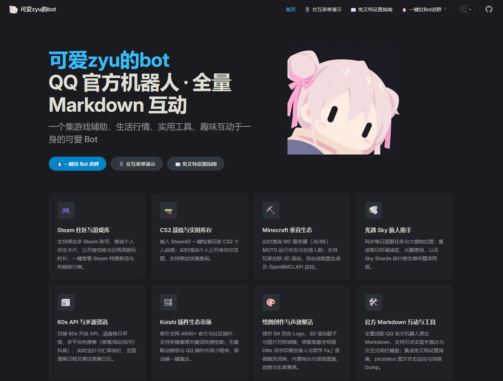
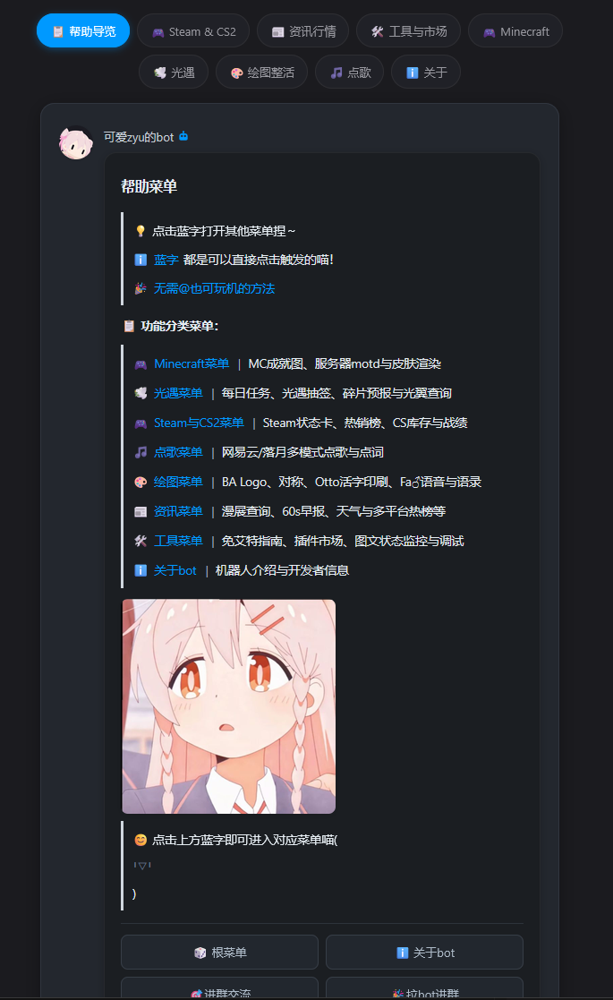

# 🤖 可爱zyu的bot 官方站点与菜单仓库

> QQ 官方机器人 · 全量 Markdown 蓝字互动 · 游戏 / 资讯 / 工具多维互联

🌐 **在线文档与交互演示**：[https://vincentzyu233.github.io/qq-keai-zyu-O-o-bot-doc/](https://vincentzyu233.github.io/qq-keai-zyu-O-o-bot-doc/)

---

## 📸 站点与交互预览

| 🏠 首页全局视图与功能矩阵 | 📱 1:1 仿真 Markdown 菜单交互 |
| :---: | :---: |
|  |  |

---

## 📌 项目亮点

- **1:1 像素级 QQ 客户端渲染**：在 Web 网页中完美复刻手机与桌面 QQ 的消息气泡体验，支持深色（Dark）与浅色（Light）双主题随心切换。
- **真实指令点击无缝跳转与复制**：仿真官方蓝字 `<qqbot-cmd-input>` 标签，点击不仅将对应指令复制到剪贴板，还支持直接在聊天气泡内丝滑切换子菜单！
- **纯正 Git 历史演进**：`menu/` 目录完整保留了自 2026 年 6 月至今的 8 轮真实菜单升级 Commit 记录。
- **全自动双向安全同步**：内置 `scripts/sync-menus.cjs` 脚本，支持从服务器快速拉取菜单，或一键 push 推送最新菜单至生产环境热生效。

---

## 🛠️ 本地开发与构建

```bash
# 1. 安装依赖
yarn install

# 2. 启动本地开发热重载调试
yarn docs:dev

# 3. 构建静态站点
yarn docs:build

# 4. 本地预览构建产物
yarn docs:preview
```

---

## 🔄 从服务器同步最新菜单

```bash
# 复制并配置私密连接凭证
cp scripts/.env.example scripts/.env

# 执行脱敏同步（自动过滤冗余备份文件）
yarn sync:menu
```

---

## 📄 开源许可

本项目遵循 MIT 协议开源。
